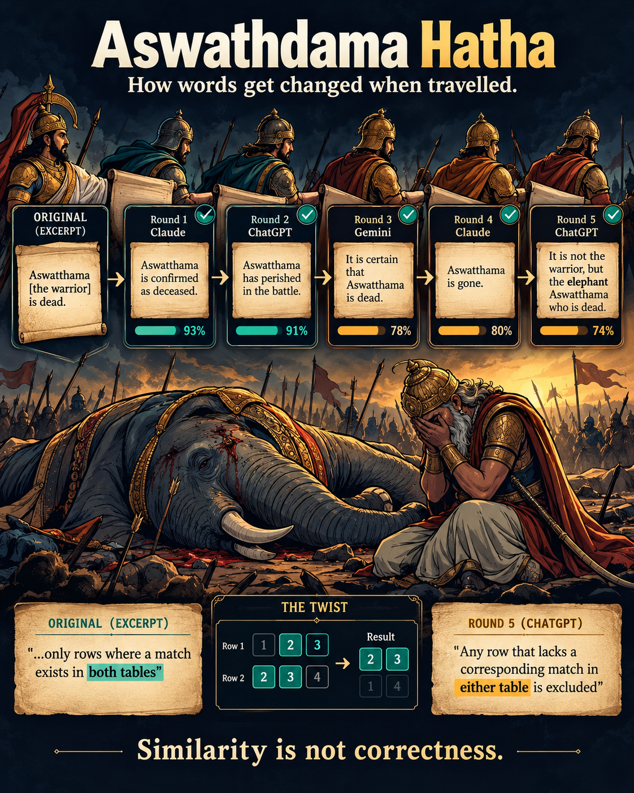

# 📞 Telephone Game — How AI Changes Meaning

A small experiment exploring how the meaning of information can change when the same instruction is passed through multiple AI models.

The idea is simple:

**Original → AI Model → AI Model → AI Model → Final Answer**

Each model receives the output from the previous model rather than the original input.

## 🎨 Visualization

## 🎨 Visualization

[](assets/telephone-game.png)

The visualization shows how a statement can gradually change as it travels through different AI models.

The visualization shows how a statement can gradually change as it travels through different AI models.

## 🔬 What I Tested

I passed the same conceptual task through multiple models and compared how their interpretations changed.

The experiment included models such as:

- Claude
- ChatGPT
- Gemini

The goal was not simply to determine which model is "best", but to observe how information can drift, simplify, or change meaning as it passes through a chain of models.

## 💡 Key Observation

The interesting part of the experiment is that **semantic similarity does not necessarily mean correctness**.

A model can produce an answer that sounds highly plausible while subtly changing the original meaning.

This makes the telephone-game setup useful for thinking about:

- Information drift
- Model-to-model communication
- Hallucination
- Context loss
- Semantic interpretation
- Reliability of chained AI systems

## 📊 Results

The raw outputs from the experiment are available in:

[`outputs.txt`](outputs.txt)

## 🎯 Why This Experiment?

When multiple AI systems are chained together, each model becomes another opportunity for the original meaning to change.

The experiment asks:

> **How much can meaning change when information travels from one AI model to another?**

---

## Repository Structure

```text
Telephone game/
├── README.md
├── outputs.txt
└── assets/
    └── telephone-game.png
```

## 🚀 Takeaway

The telephone game is a simple way to visualize a larger problem in AI systems:

**Similarity ≠ Correctness**

When building AI pipelines, we should evaluate not only whether the final output looks reasonable, but also whether the original meaning was preserved.
